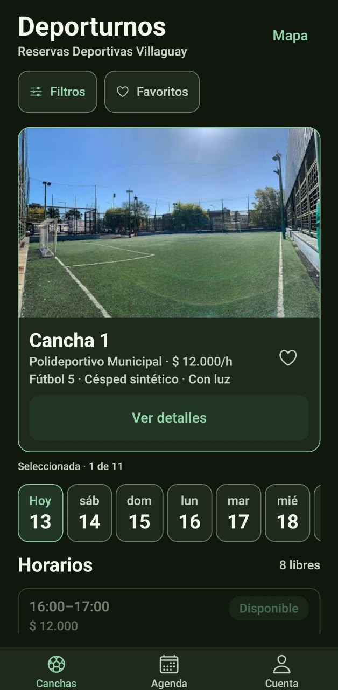
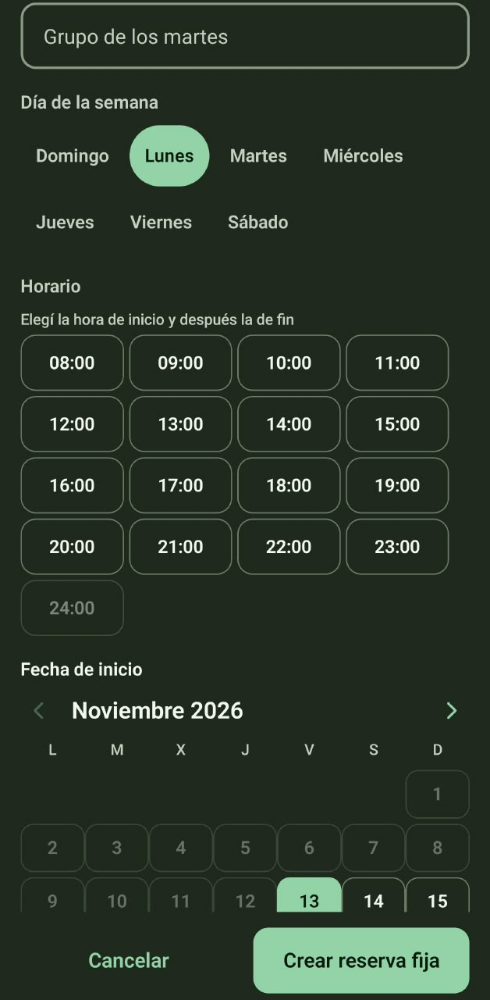
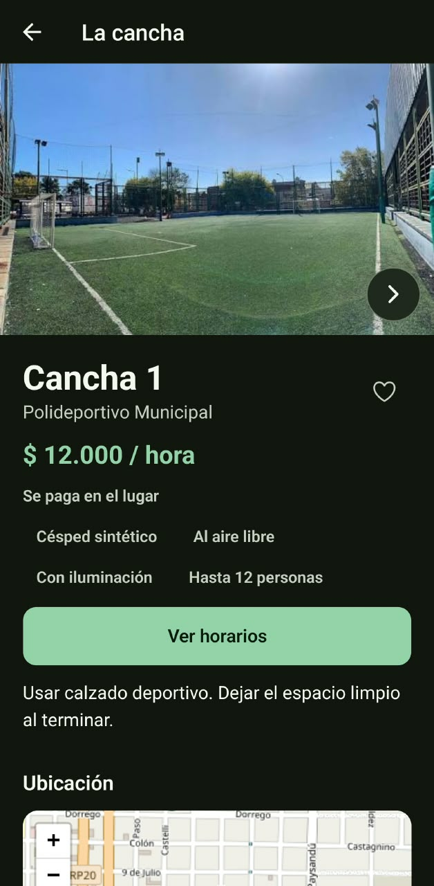
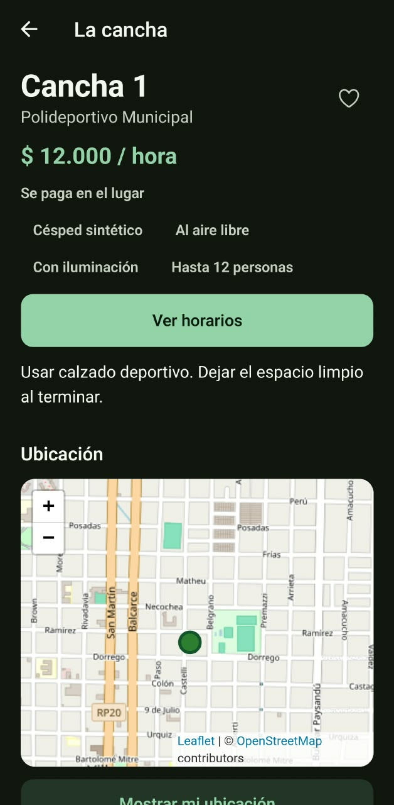

# Deporturnos

## Equipo de desarrollo

- Lucas Siano
- Andrea Elizabeth Romero
- Maximiliano Ramón Merele
- Martin Miguel Perero
- Verónica Haydeé Peluffo Bou
- Agustin Vilaboa

Aplicación móvil para consultar y reservar canchas deportivas municipales de Villaguay. Los jugadores buscan horarios y gestionan sus reservas; encargados y administradores operan la agenda y las canchas.

## Capturas de la aplicación

<p align="center">
  <a href="screenshots/captura-1.jpeg"></a>&nbsp;&nbsp;
  <a href="screenshots/captura-3.jpeg"></a>&nbsp;&nbsp;
  <a href="screenshots/captura-4.jpeg"></a>&nbsp;&nbsp;
  <a href="screenshots/captura-5.jpeg"></a>
</p>

## Funcionalidades

- Explorar y filtrar canchas, consultar disponibilidad y ubicaciones en OpenStreetMap + Leaflet.
- Reservar y cancelar turnos, guardar favoritos y presentar el código QR de una reserva.
- Gestionar agenda, ingresos, bloqueos, reservas fijas y tarifas según el rol.
- Consultar datos guardados sin conexión y documentar el estado de las canchas con fotos y videos.

## Tecnologías y arquitectura

| Componente | Tecnologías |
|---|---|
| Aplicación móvil | React Native 0.81, Expo SDK 54, TypeScript, Expo Router |
| Integración | Axios y servicios propios para consumir la API REST |
| Dispositivo | `expo-sqlite`, `expo-sqlite/kv-store`, `expo-secure-store` y módulos Expo para cámara, archivos, ubicación y notificaciones |
| API de la cátedra | NestJS 12, TypeORM y SQLite; se levanta localmente con Docker Compose |

El frontend consume la API por HTTP; no se conecta directamente con la base de datos. La API es un proyecto separado y no se modifica desde la aplicación.

## Inicio rápido en Windows

Requisitos: Node.js **24.15.0** (`reservas-deportivas/.nvmrc`), npm, Docker Desktop con Docker Compose y Expo Go compatible con SDK 54 o un emulador Android.

### 1. Levantar la API

Desde la raíz del repositorio, en una terminal PowerShell:

```powershell
cd api-reservas-deportivas
docker compose up --build
```

Esperá a que finalice el arranque y comprobá la API desde otra terminal:

```powershell
Invoke-RestMethod http://localhost:3000/salud
```

### 2. Configurar y ejecutar la app

En una segunda terminal PowerShell, desde la raíz del repositorio:

```powershell
cd reservas-deportivas
npm ci
if (-not (Test-Path .env)) { Copy-Item .env.example .env }
```

Editá `.env` y configurá `EXPO_PUBLIC_API_URL` para el dispositivo. El archivo `.env` es local y no se debe subir al repositorio.

| Dónde se ejecuta la app | URL de la API local |
|---|---|
| Emulador Android Studio | `http://10.0.2.2:3000` |
| Celular en la misma red Wi-Fi | `http://<IP-privada-de-la-PC>:3000` |
| Navegador en la PC | `http://localhost:3000` |

Luego iniciá Expo:

```powershell
npm start -- --go --lan
```

Para un celular físico, la PC y el teléfono deben estar en la misma red; permití Docker Desktop y Node.js en el firewall si Windows lo solicita. `localhost` en el teléfono apunta al propio teléfono, no a la PC.

## Configuración de la API

- `.env.example` contiene la URL pública de demostración. Para desarrollo local, reemplazala por la dirección de la tabla anterior.
- El perfil EAS `preview` usa la URL pública configurada en `reservas-deportivas/eas.json`; no depende de Docker en la computadora del equipo.
- `EXPO_PUBLIC_API_URL` se incluye en la app, por lo que es una dirección pública de API, no un lugar para guardar contraseñas ni claves.

## Validaciones y APK

Ejecutá estos comandos desde `reservas-deportivas/`:

```powershell
npm run typecheck
npm test
```

Para generar el APK Android de entrega con EAS, desde la misma carpeta:

```powershell
npx eas-cli@latest build --platform android --profile preview
```

El perfil `preview` genera un APK instalable, usa la API pública y funciona sin Metro. Requiere una cuenta de Expo/EAS.

## Uso sin conexión

La app puede mostrar datos que ya guardó en el dispositivo, como el catálogo, horarios consultados y reservas con su QR. Reservar, cancelar, validar ingresos, administrar canchas y transferir fotos o videos requiere conexión con la API; las operaciones no se encolan para sincronizarse más tarde.

## Documentación

- [Guía de ejecución](docs/GUIA_EJECUCION.md)
- [README de la API y Docker](api-reservas-deportivas/README.md)
- [Especificación maestra](docs/Requisitos-obligatorios/ESPECIFICACION_MAESTRA_DEPORTURNOS.md)
